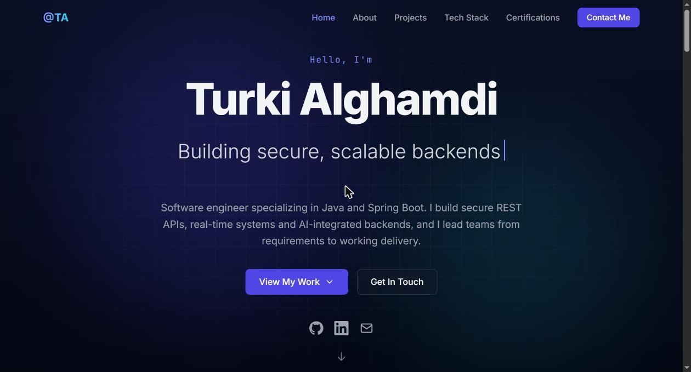
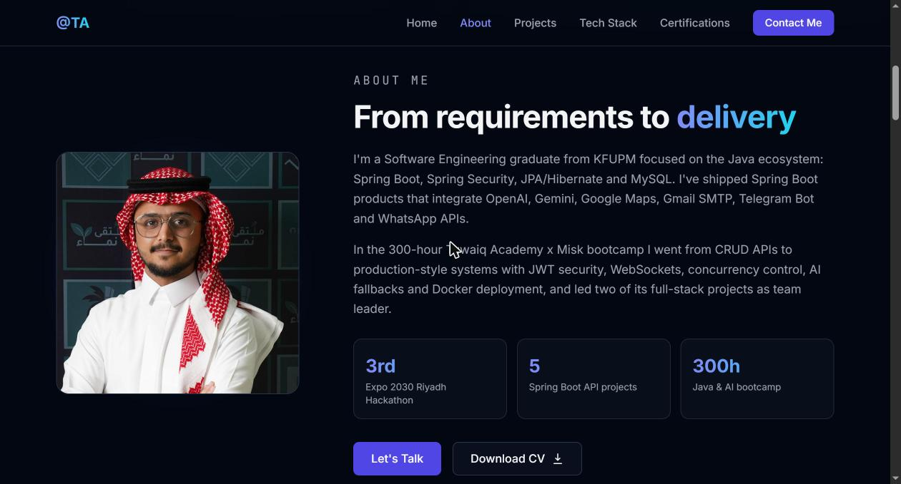
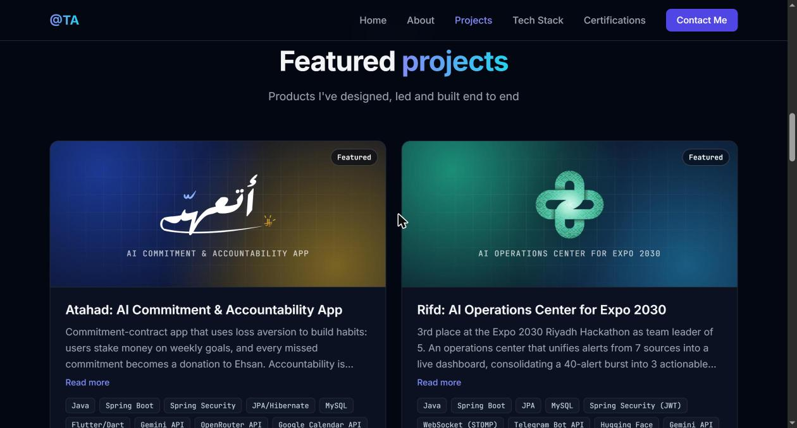
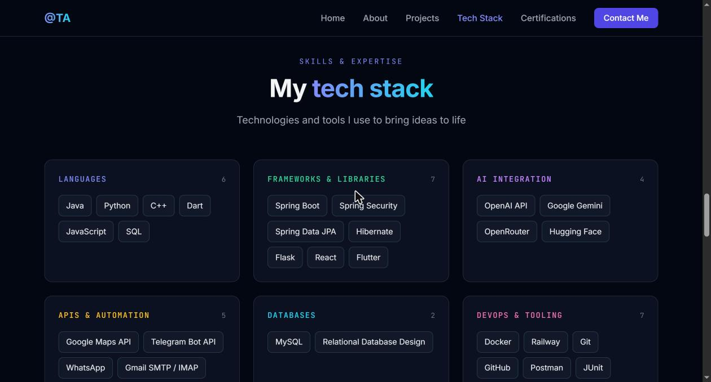
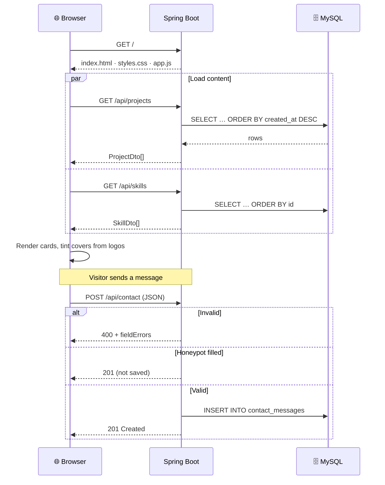
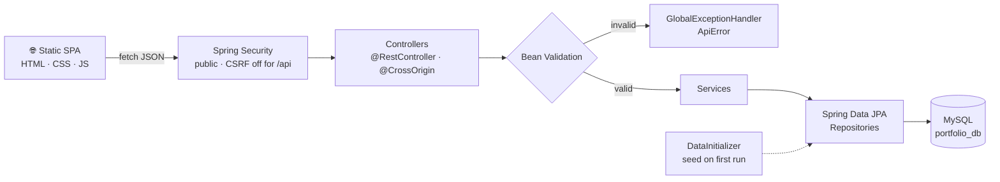
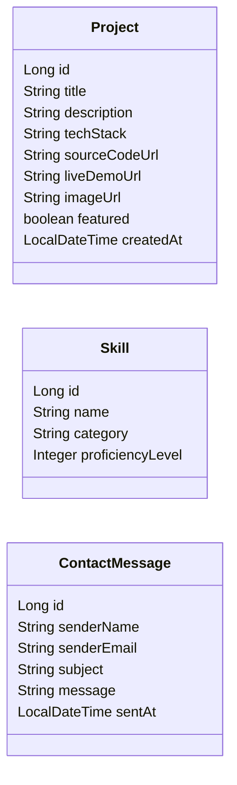

<div align="center">


# Turki Alghamdi · Portfolio

**Software Engineer · Backend Developer · Riyadh, Saudi Arabia**

### From requirements to working delivery

A personal portfolio powered by a Spring Boot REST API and MySQL, with a hand-built JavaScript frontend.

<br>

<a href="https://turki-alghamdi.up.railway.app"></a>

<br><br>

<a href="https://www.linkedin.com/in/turki-abdullah-alghamdi"></a>
<a href="mailto:kfupm.turki@gmail.com"></a>
<a href="src/main/resources/static/files/Turki_Alghamdi_CV.pdf"></a>

<br><br>


<br>


<br>

**4 REST endpoints · 3 entities · 0 frontend dependencies · every card driven by the database**

</div>

---

> A portfolio shouldn't need a redeploy every time I finish a project.
> Here the **projects and the tech stack live in MySQL** and are served by a **Spring Boot API**; the page fetches them and builds itself.
> Add a row in DataGrip, refresh, and it's on the site. Visitors can reach me through a **validated contact form** that stores every message in the database.
>
> It's also a small, honest example of how I like to build backends: **layered, validated, and easy to read.**

<div align="center">

 
 

</div>

## 📑 Table of Contents

- [Featured Work](#-featured-work)
- [Features](#-features)
- [How It Works](#-how-it-works)
- [Architecture](#-architecture)
- [Data Model](#-data-model)
- [API](#-api)
- [Project Structure](#-project-structure)
- [Getting Started](#-getting-started)
- [Managing Content](#-managing-content)
- [About Me](#-about-me)

## 🏆 Featured Work

The projects shown on the site, all built with Spring Boot during the Tuwaiq Academy x Misk bootcamp:

<table>
  <tr>
    <td align="center" width="33%" valign="top">
      <a href="https://github.com/gTurki/Atahad"></a><br><br>
      <b><a href="https://github.com/gTurki/Atahad">Atahad · أتعهّد</a></b><br>
      <sub>AI Commitment & Accountability App</sub><br><br>
      <b>193</b> endpoints · 4-person team<br><br>
      <sub>Stake money on weekly goals; missed commitments become donations to Ehsan. AI-verified proofs: photo, timer, quiz, GPS, steps.</sub>
    </td>
    <td align="center" width="33%" valign="top">
      <a href="https://github.com/gTurki/Rifd"></a><br><br><br>
      <b><a href="https://github.com/gTurki/Rifd">Rifd</a></b><br>
      <sub>AI Operations Center for Expo 2030</sub><br><br>
      🥉 <b>3rd place</b> · Team leader<br><br>
      <sub>Unifies alerts from 7 sources into a live dashboard; AI severity, duplicate merging and fire/smoke detection. 18 entities, 70 endpoints. <a href="https://rifd-frontend.vercel.app">Live demo</a></sub>
    </td>
    <td align="center" width="33%" valign="top">
      <a href="https://github.com/gTurki/Ejad"></a><br><br><br>
      <b><a href="https://github.com/gTurki/Ejad">Ejad</a></b><br>
      <sub>AI Lost & Found Platform</sub><br><br>
      <b>103</b> endpoints · Team leader<br><br>
      <sub>AI matching engine scores lost/found reports and notifies owners above 70% via in-app, email and WhatsApp.</sub>
    </td>
  </tr>
</table>

## ✨ Features

### 🗂️ Data-driven content
- **Projects** and **skills** are loaded from the API with `fetch`, so editing the database updates the site with no rebuild.
- **Featured projects** float to the top with a badge; `/api/projects/featured` returns only those.
- **Project covers**: a logo is shown on a gradient that is **tinted from the logo's own colors** (sampled in the browser with a canvas hue histogram). A wide, opaque screenshot fills the whole cover instead. No image? A generated cover with the project name.
- **Seed data** fills the database with my real projects and skills on the first run, and never overwrites your edits.

### ✉️ Contact form
- **Two layers of validation**: instant checks in the browser, then Bean Validation on the server (`@NotBlank`, `@Email`, `@Size`).
- **Field-level errors**: the API returns one message per field, and the form shows each one under its input.
- **Honeypot spam trap**: a hidden field only bots fill in. Bot messages get a normal "thanks" but are never saved, so they don't retry.
- **Rate limit**: at most **3 messages per 10 minutes** per visitor (sliding window, by IP). Extra attempts get `429 Too Many Requests` with a `Retry-After` header and a friendly message. Configurable with `CONTACT_RATE_LIMIT_MAX` / `CONTACT_RATE_LIMIT_WINDOW`.
- **Email notifications**: every new message is emailed to me via Brevo (see [below](#-email-notifications-brevo)).

### 🎨 Frontend
- Dark theme, **typing hero**, **scroll-spy** navigation, reveal-on-scroll animations, loading skeletons.
- Fully **responsive** with a mobile menu; respects `prefers-reduced-motion`.
- **Safe rendering**: all API text is HTML-escaped, and only `http(s)` links are rendered.
- **Zero dependencies**: plain HTML, CSS and JavaScript, with no build step.

### 🛡️ Backend
- Clean **controller → service → repository** layering, with Java **records** as DTOs.
- One **global error format** via `@RestControllerAdvice`.
- **Spring Security** configured for a public site; **CORS** via `@CrossOrigin` with a configurable origin.

## 🔁 How It Works



## 🏗️ Architecture



## 🗄️ Data Model



| Table | Notes |
|---|---|
| `projects` | `tech_stack` is stored comma-separated and returned as a JSON array. `created_at` is set automatically. |
| `skills` | Grouped by `category` in the UI; categories appear in the order their first skill was inserted. |
| `contact_messages` | `sent_at` is set automatically. |

## 📊 API

All endpoints return JSON.

| Method | Endpoint | Description |
|---|---|---|
| `GET` | `/api/projects` | All projects, newest first |
| `GET` | `/api/projects/featured` | Featured projects only |
| `GET` | `/api/skills` | All skills |
| `POST` | `/api/contact` | Send a contact message |

<details>
<summary><b>Example responses</b></summary>

<br>

**`GET /api/projects/featured`**

```json
[
  {
    "id": 2,
    "title": "Rifd: AI Operations Center for Expo 2030",
    "description": "3rd place at the Expo 2030 Riyadh Hackathon as team leader of 5. …",
    "techStack": ["Java", "Spring Boot", "JPA", "MySQL", "Spring Security (JWT)", "WebSocket (STOMP)"],
    "sourceCodeUrl": "https://github.com/gTurki/Rifd",
    "liveDemoUrl": "https://rifd-frontend.vercel.app",
    "imageUrl": "files/projects/rifd.png",
    "featured": true,
    "createdAt": "2026-10-01T00:00:00"
  }
]
```

**`POST /api/contact`**

```bash
curl -X POST http://localhost:8080/api/contact \
  -H "Content-Type: application/json" \
  -d '{"senderName":"Jane","senderEmail":"jane@example.com","subject":"Hello","message":"Nice work!"}'
```

`201 Created`

```json
{ "id": 1, "status": "received", "detail": "Thanks for reaching out! I'll get back to you soon.", "sentAt": "2026-11-03T18:33:39" }
```

`400 Bad Request`

```json
{
  "status": 400,
  "error": "Bad Request",
  "message": "Validation failed",
  "fieldErrors": { "senderEmail": "Email must be valid", "message": "Message is required" },
  "timestamp": "2026-11-03T18:33:39"
}
```

</details>

## 📁 Project Structure

```
Portfolio
├── src/main/java/com/example/portfolio
│   ├── config       # SecurityConfig, DataInitializer (seed data)
│   ├── controller   # ProjectController, SkillController, ContactController
│   ├── dto          # Records: ProjectDto, SkillDto, ContactMessageRequest/Response, ApiError
│   ├── entity       # JPA entities: Project, Skill, ContactMessage
│   ├── exception    # GlobalExceptionHandler: one error format for the API
│   ├── repository   # Spring Data JPA repositories
│   └── service      # Business logic
├── src/main/resources
│   ├── application.properties
│   └── static
│       ├── index.html
│       ├── css/       # styles.css
│       ├── js/        # app.js: fetch, rendering, typing hero, contact form
│       └── files/     # CV, profile photo, projects/ logos
└── docs             # README screenshots
```

## 🚀 Getting Started

**Requirements:** JDK 21+ and MySQL 8 on `localhost:3306`.

```bash
git clone https://github.com/gTurki/Portfolio.git
cd Portfolio
./mvnw spring-boot:run          # Windows: mvnw.cmd spring-boot:run
```

Open **http://localhost:8080**. The `portfolio_db` database is created if it doesn't exist, Hibernate creates the tables, and the seed data is inserted on the first start.

| Setting | Default | Description |
|---|---|---|
| `DB_USERNAME` (env) | `root` | MySQL user |
| `DB_PASSWORD` (env) | *(empty)* | MySQL password |
| `app.cors.allowed-origin` | `http://localhost:5173` | Extra origin allowed to call `/api/**` (the bundled UI doesn't need it) |
| `app.seed-sample-data` | `true` | Seed projects and skills when the tables are empty |

### ☁️ Deploying (Railway)

The repo includes a `Dockerfile`, and the app reads its port (`PORT`) and database (`MYSQLHOST`, `MYSQLPORT`, `MYSQLDATABASE`, `MYSQLUSER`, `MYSQLPASSWORD`) from environment variables.

1. **New Project → Deploy from GitHub repo** → pick this repo.
2. **+ Create → Database → MySQL**.
3. In the app's **Variables**, reference the database: `MYSQLHOST=${{MySQL.MYSQLHOST}}`, and the same for the other four.
4. **Settings → Networking → Generate Domain**.

Tables and seed data are created on the first start; every push to `main` redeploys.

### 📧 Email notifications (Brevo)

Every new contact message is also emailed to me through [Brevo](https://www.brevo.com)'s HTTPS API (which works on hosts that block SMTP). Sending happens in the background **after** the message is saved, so a slow or failing email never affects the visitor. Hitting *Reply* in the email answers the visitor directly.

| Variable | Description |
|---|---|
| `BREVO_API_KEY` | Brevo API key (**SMTP & API → API Keys**) |
| `BREVO_SENDER_EMAIL` | A sender verified in Brevo (**Senders, Domains & Dedicated IPs**) |
| `NOTIFY_EMAIL` | Where notifications go (defaults to my Gmail) |

Without `BREVO_API_KEY` and `BREVO_SENDER_EMAIL`, notifications are simply turned off.

## 🛠️ Managing Content

Everything on the site except the About and Certifications text comes from the database. Use any SQL client (I use **DataGrip**):

| To… | Do this |
|---|---|
| Add a project | Insert a row into `projects`; set `featured = 1` for the badge |
| Add a cover | Put an image in `static/files/projects/` and set `image_url`, e.g. `files/projects/rifd.png` |
| Add a skill | Insert into `skills` with a `category` (new categories get a new card) |
| Read messages | `SELECT * FROM contact_messages ORDER BY sent_at DESC;` |

## 👋 About Me

<table>
  <tr>
    <td width="160" align="center" valign="top">
      <br>
      <b>Turki Alghamdi</b><br>
      <sub>Backend Developer</sub>
    </td>
    <td valign="top">

Software Engineering graduate from **KFUPM** focused on **Java & Spring Boot**: secure REST APIs, real-time systems and AI-integrated backends. I led a 5-member team to **3rd place in the Expo 2030 Riyadh Hackathon**, and I bring Agile team leadership and **CBP-PM** certified project management to every build.

- 🎓 BSc Software Engineering, KFUPM (2026)
- 💻 Java Web Development & AI bootcamp (300 h), Tuwaiq Academy x Misk
- 🏅 SCE Professional Accreditation · CBP-PM · CCNA

    </td>
  </tr>
</table>

---

<div align="center">

<sub>Built with ☕ Java, 🍃 Spring Boot and 🐬 MySQL by <b>Turki Alghamdi</b></sub><br>
<sub><a href="https://github.com/gTurki">GitHub</a> · <a href="https://www.linkedin.com/in/turki-abdullah-alghamdi">LinkedIn</a> · <a href="mailto:kfupm.turki@gmail.com">Email</a></sub>

</div>
